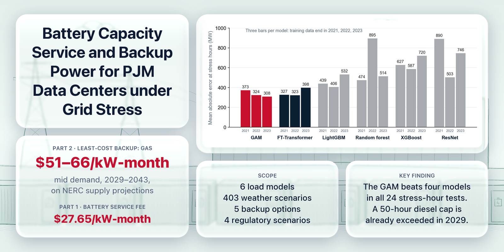
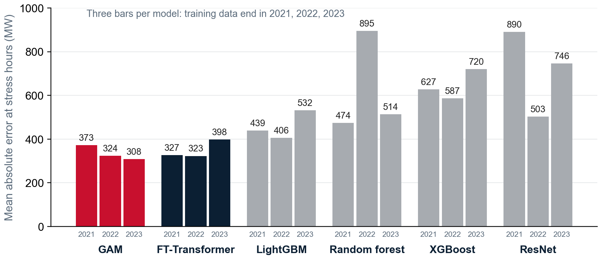

A two-part study of how a new 50 MW data center campus in PJM's Dominion zone (Loudoun County, Virginia) can keep its power when the grid is short. Part 1 prices a behind-the-meter battery as the campus's own capacity under a proposed PJM rule. After FERC rejected that rule, Part 2 asks how many hours a year the campus will be called off the grid in 2029–2043 and which on-site backup is cheapest.

*Work in progress, independent study at Carnegie Mellon University (since Aug. 2026). Advisor: Prof. Nathan Williams (CMU Africa).*

## Part 1: battery capacity service (report dated October 9, 2026)

- **Design.** A 50 MW / 500 MWh lithium iron phosphate battery behind the customer's meter, registered as the load's demand response. At PJM's 90% demand-resource rating it accredits 45.0 MW, 97.5% of the load's 46.16 MW obligation, and its 10 hours cover 15 of the 16 recorded Dominion-zone dispatch days.
- **Price.** The minimum availability fee that gives equity a 12% return is **$27.65/kW-month** over a 15-year contract.
- **Financing.** CAPEX of $135.1M is funded by $55.7M of debt and $79.4M of equity; selling the 30% investment tax credit returns $36.5M in the first year. Project IRR is 8.68% and the minimum debt service coverage ratio is 1.42x.
- **Sensitivity.** Installed cost moves the fee most, from $20.22 to $35.62/kW-month across NREL's 2028 low and high cost projections.
- **Recommendation.** Study further on a limited budget up to a go/no-go gate on March 31, 2027, conditional on FERC accepting the rule.

## The FERC order

Part 1 assumes PJM's proposed Interim Resource Adequacy Service (IRAS), under which a new large load that does not bring its own new capacity (BYONC) is curtailed first in a capacity shortage. On October 9, 2026, the day the report was submitted, FERC accepted PJM's definition of Large Load and the Large Load Registry but rejected IRAS and the BYONC rules (197 FERC ¶ 61,019, Docket No. ER26-3515-000). The capacity service therefore has no market under the current rules, and the condition in the Part 1 recommendation failed.

The underlying problem remains: PJM is short of capacity, and a large campus can still be told to run on its own power. Part 2 studies that case from the operator's side.

## Part 2: backup power under grid stress (results as of November 16, 2026)

Five on-site options are compared for the same 50 MW campus: diesel, gas, battery, battery + diesel, and battery + gas. Four regulatory scenarios set when the campus is called off the grid and how diesel may be used: only under a DOE emergency order (A), or on every stress day with diesel limited by its 500-hour permit (B), capped at 50 non-outage hours a year (C), or not allowed (D).



- **Load model.** Six models were trained on Dominion-zone hourly load with the inputs of PJM's own load forecast: a GAM, a random forest, LightGBM, XGBoost, a ResNet, and an FT-Transformer. All follow one protocol: a 60-trial search, three rolling origins (training to the end of 2021, 2022, and 2023), and Welch tests with a Bonferroni correction. The GAM beats the three tree models and the ResNet in all 24 stress-hour comparisons; these four underpredict stress hours by 0.4–1.5 GW. Against the FT-Transformer there is no stable difference, so the simpler model, the GAM, is used.
- **Stress hours.** A stress day is one whose PJM system peak reaches the range in PJM's capacity assessments (149.9–153.8 GW in summer). Hours are counted over PJM's 403 hourly weather scenarios with ten years of model residuals (4,030 simulated years) and NERC's three supply projections. On all three, a cap of 50 diesel hours a year is already exceeded in 2029, and a 6-hour battery holds only until 2029–2031.
- **Cost.** On NERC's three supply projections, gas (seven 10 MW units) is the cheapest long-run option in all four scenarios and on all three demand paths, at **$51–66 per kW of campus load per month** at mid demand in scenarios B–D. Diesel exceeds its 500-hour permit in 2031–2037 even at low demand, and batteries cannot cover the long events.
- **Bridge.** Gas can be in service in May 2030 at the earliest, so the first years need a diesel or battery + diesel bridge.

These results come from an interim report and may still change. The Part 2 report and modeling code are not in this repository yet; `pipeline/` holds the data preparation they build on.

## Repository contents

| Path | Contents |
|---|---|
| `report/BTM_Battery_Capacity_Service_Report.pdf` | Part 1 feasibility report: market, technical, financial, sensitivity, environmental and social, regulatory, risk and development plan |
| `model/BTM_Battery_Capacity_Service_Model.xlsx` | Part 1 Excel model: Inputs, Events, Technical, Costs, CashFlow, Results, Sensitivity and Customer sheets. Orange cells are inputs; the ReadMe sheet explains the layout and the Goal Seek step that solves the fee |
| `pipeline/` | Python pipeline that cleans ten years of hourly load, price and weather data for the Dominion zone and builds the modelling panel |
| `figures/model_comparison.png` | Part 2: stress-hour error of the six load models at three training cut-offs |

## Data pipeline

`pipeline/run_all.py` cleans each raw source to its own CSV and joins load, day-ahead prices and weather into an hourly panel keyed on UTC, hour-beginning:

| Source | Content | Redistribution |
|---|---|---|
| PJM Data Miner 2 | Metered load (Dominion zone and PJM total), day-ahead zonal LMPs, ancillary reserve prices, regulation prices, network service peak loads, historical load forecasts | Not allowed; download your own copy |
| EIA-930 Hourly Electric Grid Monitor | Load for PJM's 20 subregions, used as a public substitute for PJM load | Public domain |
| NOAA NCEI Global Hourly (ISD) | Temperature, dew point and pressure at Washington Dulles (station 72403093738) | Public domain |
| Iowa Environmental Mesonet ASOS archive | The same Dulles observations, used for recent hours that ISD has not yet published | Not included; cite the Iowa Environmental Mesonet |

No data files are included. With PJM files, the main panel runs from August 2016. `python pipeline/run_all.py --public` builds a second panel of load and weather only, from EIA-930 (2019 onward), NOAA ISD and the Iowa Environmental Mesonet, so it can be reproduced and shared without any PJM file. Each step's row counts and the reasons for dropped or missing values are written to `pipeline/data_quality_report.md`.

To run it, put the raw downloads under `original_data/` at the repository root:

```
original_data/
  Hourly_Load_Metered/*.csv                      PJM hrl_load_metered
  Day_Ahead_Hourly_LMPs/*.csv                    PJM da_hrl_lmps, zonal nodes
  Day_Ahead_Ancillary_Service_LMPs/*.csv         PJM da_ancillary_services
  Annual_Zonal_Network_Service_Peak_Loads/*.csv  PJM annual_zonal_nspl
  load_frcstd_hist.csv                           PJM historical load forecasts
  reg_prices.csv                                 PJM reg_market_results
  pjm/EIA930_SUBREGION_*.csv.gz                  EIA-930 six-month subregion files
  weather/iad_<year>.csv                         NOAA ISD, one file per year
  weather/iem_iad_*.csv                          Iowa Environmental Mesonet ASOS, station IAD
```

Missing sources are skipped. Then run:

```bash
pip install -r pipeline/requirements.txt
python pipeline/run_all.py --public
```

The cleaned CSVs are written to `pipeline/`.
